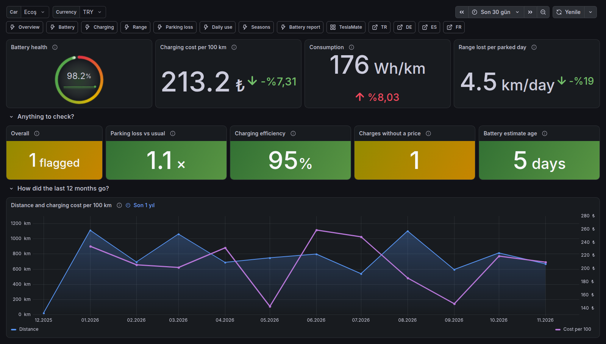
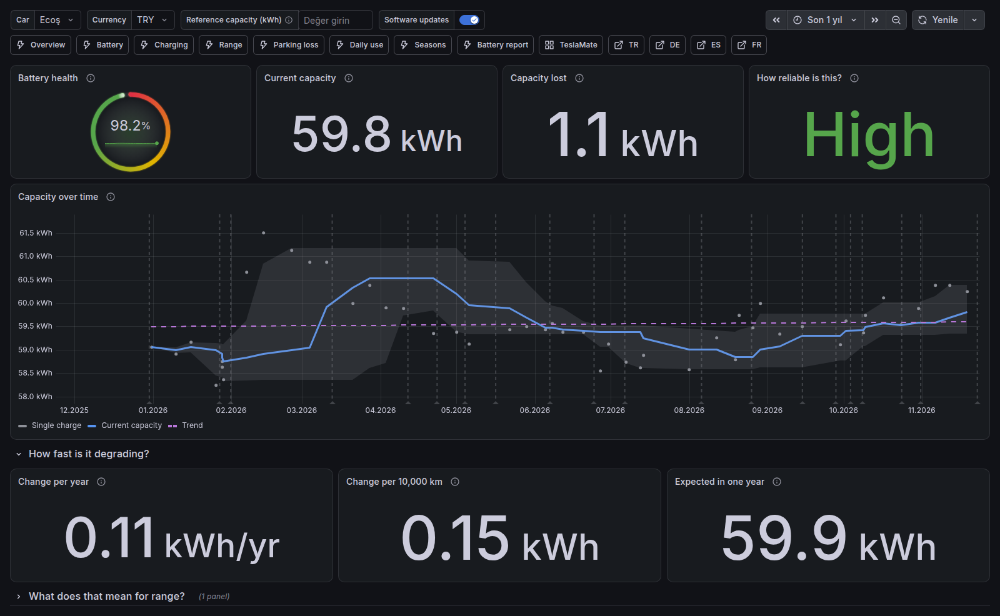
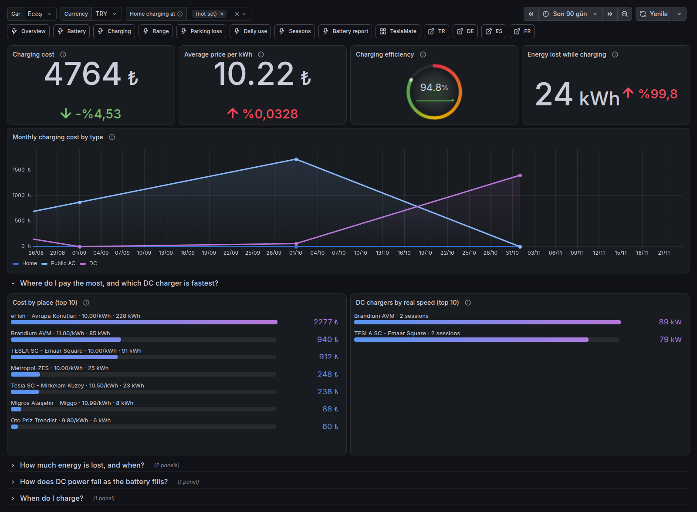
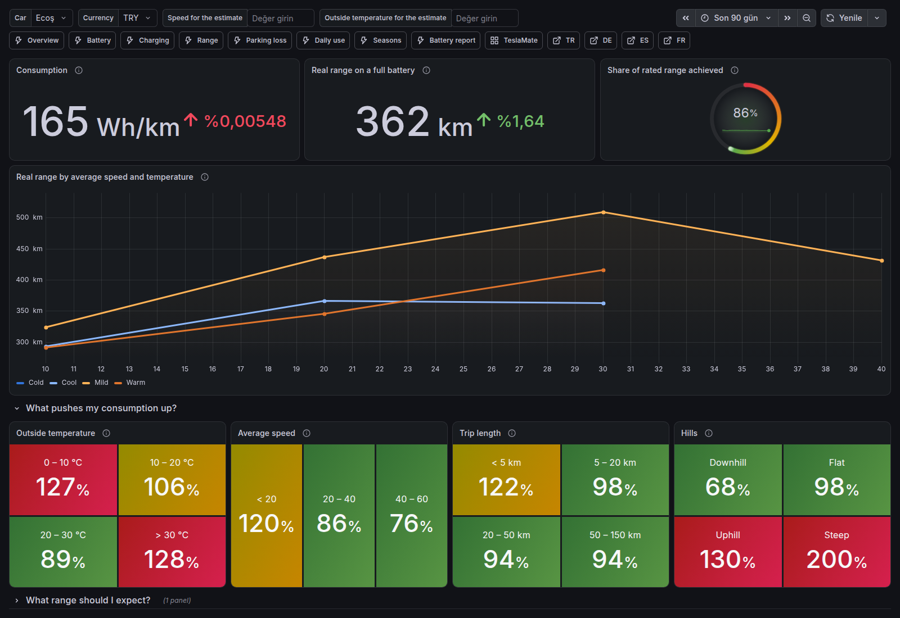
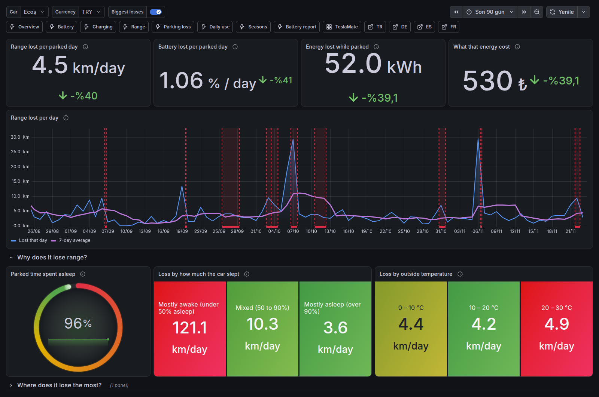
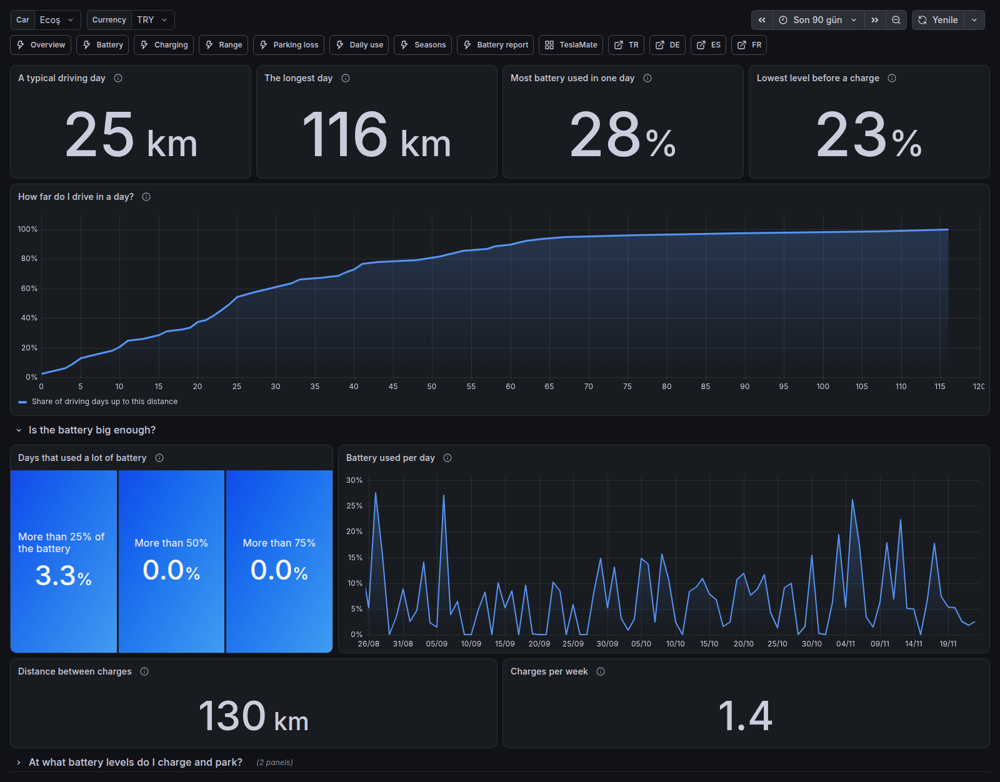
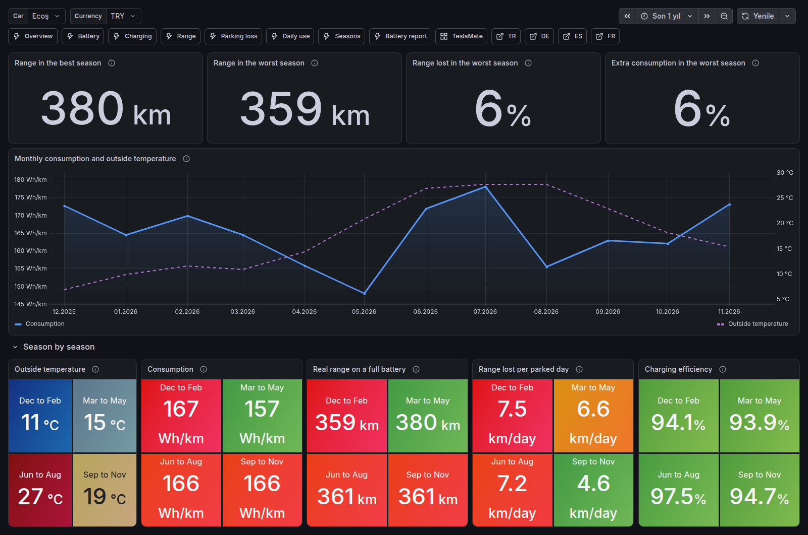
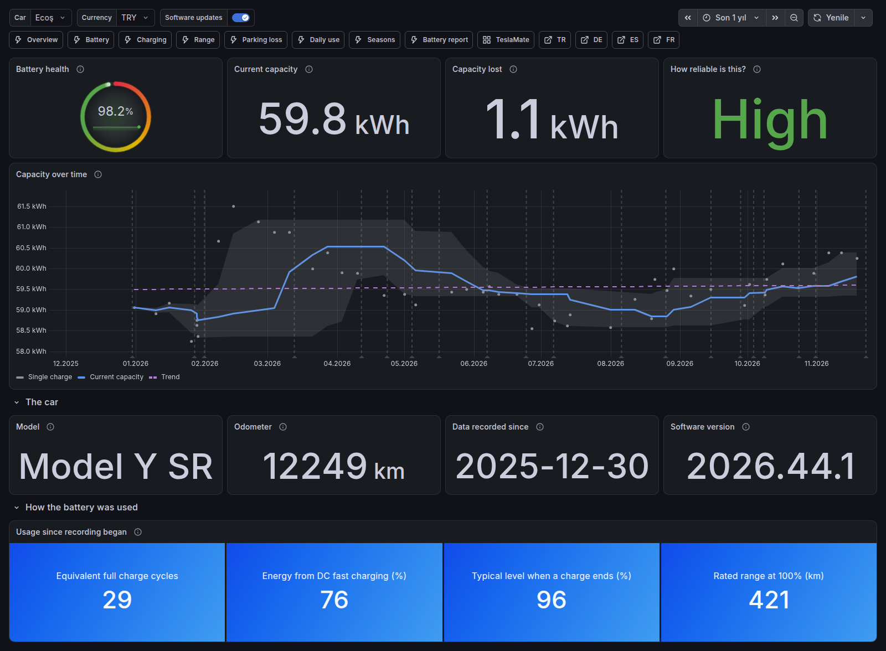

# TeslaMate Ecos Dashboards

[](https://www.gnu.org/licenses/gpl-3.0)
[](https://grafana.com)

Eight Grafana dashboards for [TeslaMate](https://github.com/teslamate-org/teslamate) that answer the questions its built-in dashboards leave open: what state the battery is in, what charging really costs, what range you actually get, and what the car loses while parked.



> **Why "Ecos"?** It is the name of the author's car, on which these dashboards are built and tested.

**Version 3 is a redesign, not an update.** v2 had 7 dashboards and 91 panels, many of them tables and single numbers that repeated TeslaMate or each other. v3 has 8 dashboards and 79 panels, no tables and no bar charts, and every panel answers a stated question. v2 remains available on the [`v2` branch](../../tree/v2); see [Upgrading from v2](#upgrading-from-v2).

## Dashboards

Every dashboard has the same shape: up to four headline numbers, each with its change against the previous period; one main chart; a "why" row; and collapsed detail rows. A bar at the top links the eight dashboards and keeps the selected car and time range.

| Dashboard | Questions it answers | Main chart |
|-----------|----------------------|------------|
| **Overview** | Is there anything I should look at? How did this period compare with the last? | Distance and charging cost per 100 km/mi, last 12 months |
| **Battery** | How much capacity is left? How fast is it going? How far can I trust the estimate? | Capacity over time with an uncertainty band and software-update markers |
| **Charging** | What do I pay, and where? How much energy and money is lost while charging and parking? Which DC charger is really fast? When do I charge? | Monthly cost by type (Home / Public AC / DC) |
| **Range** | What range do I really get, and what should I expect at a given speed and temperature? What pushes my consumption up: speed, cold, short trips or hills? | Real range by average speed, one line per temperature band |
| **Parking loss** | How much range disappears while parked, what does it cost, and why? | Range lost per day with the ten worst parks marked |
| **Daily use** | How far do I drive in a day? Is the battery big enough? At what levels do I charge and park? | Share of driving days up to each daily distance |
| **Seasons** | What does the worst time of year cost me in range and energy? | Monthly consumption against outside temperature |
| **Battery report** | What can I show a buyer about this battery? A one-page summary with no locations, costs or driver data. | Capacity over time |

<details>
<summary><b>Screenshots of every dashboard</b></summary>

| | |
|---|---|
| **Battery**<br> | **Charging**<br> |
| **Range**<br> | **Parking loss**<br> |
| **Daily use**<br> | **Seasons**<br> |
| **Battery report**<br> | |

</details>

What is deliberately **not** here because TeslaMate already has it: drive and charge lists, maps, visited places, the state timeline, the update list, mileage, and the state-of-charge heatmap.

## Installation

Requirements: TeslaMate 4.0 or later with the Grafana it ships (developed and tested on Grafana 13.3; older Grafana versions are untested and may not draw the radial gauges), and the default PostgreSQL datasource with uid `TeslaMate`. No extra Grafana plugins, and nothing is written to the TeslaMate database.

Clone the repository next to your TeslaMate `docker-compose.yml`:

```bash
git clone https://github.com/hyuce/Teslamate-EcosDashboards.git
```

Add two volumes to the `grafana` service:

```yaml
grafana:
  volumes:
    - ./Teslamate-EcosDashboards/provisioning.yml:/etc/grafana/provisioning/dashboards/ecos.yml
    - ./Teslamate-EcosDashboards:/TeslamateEcosDashboards
```

Recreate the container (`restart` does not pick up new volumes):

```bash
docker compose up -d grafana
```

The dashboards appear in the **Teslamate Ecos** folder within about 30 seconds. Start at **Ecos · Overview** (`http://<host>:3000/d/ecos3-overview`).

To install by hand instead, import the files in [`dashboards/en/`](dashboards/en/) (or another language folder next to it) through **Dashboards → New → Import**.

## Languages

The dashboards come in **English, Turkish, German, Spanish and French**. Provisioning creates one folder per language (*Teslamate Ecos*, *Teslamate Ecos (Türkçe)*, *(Deutsch)*, *(Español)*, *(Français)*). At the right of every dashboard's navigation bar, the links `TR` `DE` `ES` `FR` `EN` open the same dashboard in that language with the same car and time range. To install fewer languages, delete the providers you do not want from [`provisioning.yml`](provisioning.yml).

If you installed an earlier v3 build, restart Grafana once (`docker compose restart grafana`) so it reads the new `provisioning.yml`.

## First steps

1. **Currency.** Pick yours in the `Currency` dropdown. TeslaMate stores costs as plain numbers; this only sets the symbol.
2. **Prices.** Cost figures come from the cost TeslaMate records per charge. Set a price on each geofence in TeslaMate; the Overview flags charges that have none.
3. **Home charging.** On the Charging dashboard, pick your home geofence(s) in `Home charging at`. Until you do, all AC charging counts as "Public AC".
4. **Range estimate (optional).** On the Range dashboard, open "What range should I expect?" and type a speed and a temperature at the top.
5. **Reference capacity (optional).** On the Battery dashboard, enter the usable capacity of the battery when new. Left empty, it is detected from your data.

Length, temperature and rated/ideal range follow your TeslaMate settings automatically.

## How the numbers are calculated

Each metric is defined once and reused, so a number is the same on every dashboard. Each panel's description (the ⓘ icon) says what it measures.

- **Change against the previous period.** The small percentage next to a headline number compares the selected time range with the range of the same length just before it.
- **Battery capacity.** One estimate per charge that added at least 100 rated km of energy: `rated range × rated efficiency ÷ usable battery level` at the end of the charge, the method TeslaMate's Battery Health uses. *Current capacity* is the median of the last 10 estimates. *Reference capacity* is the value you enter, or the 95th percentile of all estimates. Because the reference is a percentile rather than the single highest estimate, health can read slightly higher than in TeslaMate.
- **Charging efficiency.** Energy added to the battery ÷ energy drawn from the charger, weighted by energy.
- **Average price per kWh.** Cost ÷ energy drawn, over charges with a cost above zero. Free and unpriced charges are excluded.
- **Consumption.** Net: rated range used × rated efficiency ÷ distance, weighted by distance.
- **Real range.** Current capacity ÷ consumption of the selected period.
- **Parking loss.** A *park* is the time between two drives with no charging in between, from 1 hour to 30 days. Loss is the range that disappeared. "Per parked day" is total loss ÷ total parked hours × 24, so parks that lost nothing count.
- **Cost per 100 km/mi.** Charging cost in the period ÷ distance driven in the period.

## Known limitations

- **Speed is the trip's average speed**, stops included. City trips cluster at low speeds, and the range-by-speed chart only has points where there are at least 5 drives and 50 km of data.
- **DC charger network** is only reported by the car for Tesla Superchargers, so the charging curve compares Tesla with everything else, and the speed comparison is by place.
- **Battery estimates need deep charges.** Shallow charges are skipped; with few qualifying charges the Battery dashboard says its estimate is unreliable rather than showing a number.
- **Shared inputs do not persist between dashboards** unless you move with the navigation bar, which carries them along.
- **Capacity trend under one year of data** mostly reflects the seasons, not ageing.

## Upgrading from v2

v3 uses new dashboard ids (`ecos3-…`), so nothing you bookmarked in v2 is overwritten.

1. `git pull` on the default branch, then `docker compose up -d grafana`.
2. The v2 dashboards (ids `ecos-…-01`) are removed from Grafana by provisioning. To keep using them, check out the `v2` branch instead.

Panels from v2 that have no v3 equivalent: the whole Vehicle State dashboard, the total cost of ownership panel of Finance, Seasonal Range, Est. Charge Cycles, Max Rated Range, Capacity: DC Fast vs AC, Monthly Capacity Overview, Capacity vs Odometer, Charge Sessions & Capacity, Charge Duration Distribution, Charging Pattern, Deep vs Shallow Charging, Top/Bottom 10 Sessions, Recent 20 Charge Sessions, both monthly charging tables, Post-Charge Idle Time, Total Sessions, Drives by Day of Week, Recent Drives, Drain by Day of Week and the two Park Duration charts. If you relied on one of these, please open an issue and say what you used it for.

## Contributing

The JSON files in `dashboards/` are generated from sources that are not part of this repository, so please do not send pull requests that edit them. Open an issue instead and say which panel is wrong or missing and what question it should answer; the same goes for translation fixes.

## License

GNU General Public License v3.0; see [LICENSE](LICENSE).

## Acknowledgments

- [TeslaMate](https://github.com/teslamate-org/teslamate), the data logger all of this rests on
- [Teslamate-CustomGrafanaDashboards](https://github.com/jheredianet/Teslamate-CustomGrafanaDashboards), the inspiration for the first version
